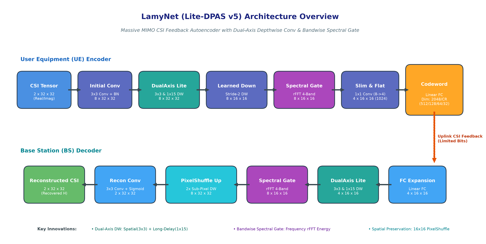
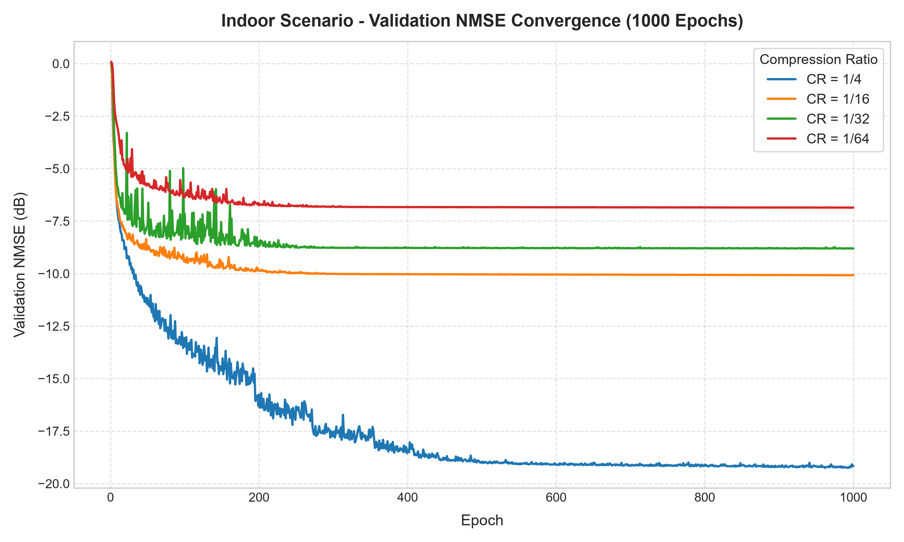
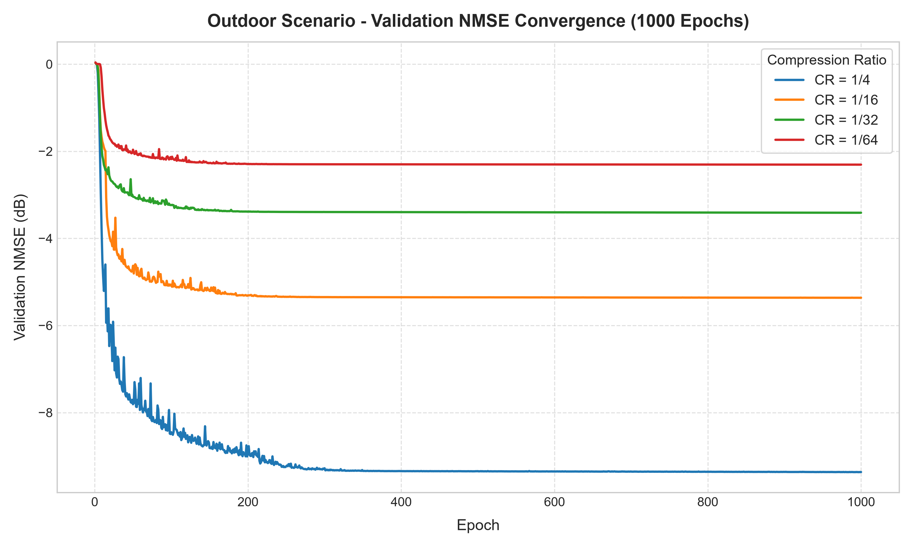
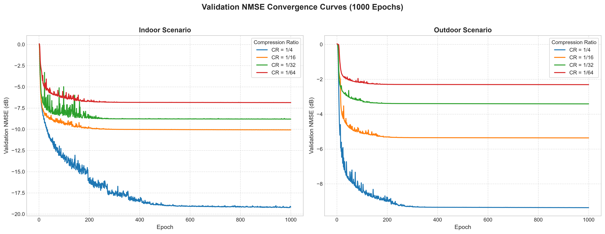
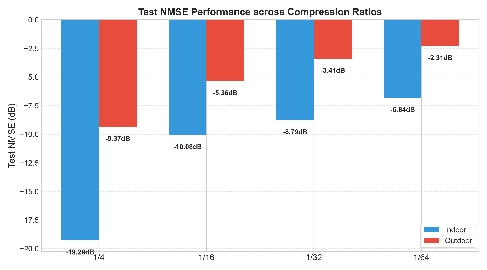

# LamyNet ❄️
> **A Lightweight Dual-Axis & Bandwise Spectral Gating Autoencoder for CSI Feedback Compression in Massive MIMO FDD Systems**

[](https://www.python.org/)
[](https://pytorch.org/)
[](LICENSE)
[](https://github.com/OhayoRINK)

English | [한국어 (Korean)](README_KR.md)

---

## Overview

**LamyNet** (developed under the project codename `Lite-DPAS v5`) is an ultra-lightweight, high-fidelity deep learning framework proposed for improving **Channel State Information (CSI) feedback compression performance** in Massive MIMO FDD systems.

Accurate downlink CSI feedback from User Equipment (UE) to the Base Station (BS) is indispensable for closed-loop beamforming and spatial multiplexing. However, in massive MIMO systems with large antenna arrays and numerous OFDM subcarriers, feedback overhead scales prohibitively. 

While baseline architectures like CsiNet pioneer autoencoder-based feedback, they incur heavy parameter footprints on UEs, struggle with long-delay multipath propagation, and suffer severe performance degradation under aggressive compression ratios.

**LamyNet** overcomes these challenges by combining:
- **Dual-Axis Depthwise Convolutions** (capturing spatial and long-range delay features with low complexity)
- **Bandwise Spectral Gating** (adaptive frequency-domain reweighting via rFFT energy distribution)
- **Spatial Feature Preservation** ($16 \times 16$ spatial grid instead of premature $8 \times 8$ bottlenecks)
- **Learned PixelShuffle Synthesis** (sub-pixel upsampling eliminating checkerboard interpolation artifacts)
- **50% Parameter Reduction** compared to standard CsiNet while maintaining competitive reconstruction accuracy across 1000-epoch training.

---

## Model Architecture



```text
========================================================================================
[UE Encoder]
Input CSI [2, 32, 32] 
   │
   ├─► ConvNormAct (2 -> 8, 3x3)
   ├─► DualAxisLiteBlock (8 channels, 3x3 Spatial DW + 1x15 Delay DW)
   ├─► LearnedDownsample (Stride-2 Conv + DualAxis, 32x32 -> 16x16)
   ├─► BandwiseSpectralGate (rFFT on delay axis, 4-band adaptive gating)
   ├─► DualAxisLiteBlock (8 channels)
   ├─► Conv1x1 Channel Slimming (8 -> 4 channels)
   └─► Flatten [1024] ──► Linear Projection ──► Codeword [Dim = 2048 / CR]
                                                         │
====================================== Uplink Feedback Channel =========================
                                                         │
[BS Decoder]                                             ▼
Codeword [Dim = 2048 / CR] ──► Linear Expansion ──► Reshape [4, 16, 16]
   │
   ├─► DualAxisLiteBlock (4 channels)
   ├─► ConvNormAct (4 -> 8, 1x1)
   ├─► BandwiseSpectralGate (8 channels, 4-band delay spectrum reweighting)
   ├─► LearnedPixelShuffleUp (Sub-pixel 2x upsampling, 16x16 -> 32x32)
   ├─► Reconstruction Conv (8 -> 2, 3x3) + Sigmoid
   └─► Reconstructed CSI [2, 32, 32]
========================================================================================
```

---

## Key Innovations

### 1. Dual-Axis Depthwise Convolution (`DualAxisLiteBlock`)
Conventional 2D convolutions naively blend angle and delay axes with quadratic kernel parameter costs. LamyNet decouples feature extraction into two parallel depthwise branches:
- **Spatial Path**: $3 \times 3$ Depthwise Conv for localized angle-domain correlations.
- **Delay Path**: $1 \times 15$ Depthwise Conv capturing extended delay-axis multipath spreads across OFDM subcarriers.
- **Pointwise Fusion**: $1 \times 1$ Conv fuses the concatenated branches with residual connections.

```text
Input Feature Map
   ├── Depthwise Conv 3×3 (Spatial Path) ────┐
   └── Depthwise Conv 1×15 (Delay Path) ────┴──► Concat ──► 1×1 Conv ──► (+) Residual ──► SiLU
```

### 2. Bandwise Spectral Gating (`BandwiseSpectralGate`)
Unlike spatial or channel attention mechanisms that operate purely in time/delay space, the **Bandwise Spectral Gate** leverages fast real-valued Fourier transforms (`torch.fft.rfft`) along the delay axis:
1. Calculates delay-domain power spectrum magnitudes.
2. Pools energy into 4 discrete frequency bands via `adaptive_avg_pool1d`.
3. Learns non-linear band-importance weights through a light MLP.
4. Dynamically scales corresponding frequency bins before inverse transform (`irfft`), filtering noise and emphasizing dominant multipath clusters.

### 3. Spatial Resolution Preservation ($16 \times 16$)
Earlier prototypes (v1–v3) compressed features directly down to an $8 \times 8$ grid, suffering significant structural detail loss. LamyNet maintains a high-resolution $16 \times 16$ spatial grid while slimming the channel count to $4$. This yields a compact $4 \times 16 \times 16 = 1024$ latent representation before feedback projection, drastically reducing parameter count in fully connected layers while protecting spatial information.

### 4. Sub-Pixel Convolution Synthesis (`LearnedPixelShuffleUp`)
Instead of fixed bilinear interpolation or parameter-heavy transposed convolutions, LamyNet employs **PixelShuffle** with learned depthwise refinement:
- Expands channel depth ($8 \rightarrow 32$) and rearranges spatial dimensions ($16 \times 16 \rightarrow 32 \times 32$).
- Completely avoids checkerboard artifacts common in deconvolutional decoders.

---

## Experimental Results

All experiments were conducted on the standard **COST2100** channel dataset (Indoor and Outdoor scenarios at carrier frequency 5.3 GHz and 300 MHz bandwidth). Models were trained from scratch for **1,000 full epochs** with `ReduceLROnPlateau` scheduling and NMSE loss.

### 1. Overall Performance Table (1,000 Epochs)

| Scenario | Compression Ratio (CR) | Encoded Dim | Best Epoch | Val NMSE (dB) | Val Cosine Sim ($\rho$) | **Test NMSE (dB)** | **Test Cosine Sim ($\rho$)** | Parameters | FLOPs (MACs) |
|:---:|:---:|:---:|:---:|:---:|:---:|:---:|:---:|:---:|:---:|
| **Indoor** | **1/4** | 512 | 992 | **-19.293** | **0.99439** | **-19.288** | **0.99438** | 1,057,188 | 5.90M (2.95M) |
| **Indoor** | **1/16** | 128 | 993 | -10.079 | 0.94890 | -10.078 | 0.94889 | 270,372 | 4.33M (2.16M) |
| **Indoor** | **1/32** | 64 | 941 | -8.804 | 0.92977 | -8.786 | 0.92941 | 139,236 | 4.07M (2.03M) |
| **Indoor** | **1/64** | 32 | 998 | -6.858 | 0.88859 | -6.839 | 0.88806 | **73,668** | **3.94M (1.97M)** |
| **Outdoor** | **1/4** | 512 | 997 | **-9.368** | **0.94014** | **-9.368** | **0.94014** | 1,057,188 | 5.90M (2.95M) |
| **Outdoor** | **1/16** | 128 | 992 | -5.364 | 0.83878 | -5.364 | 0.83877 | 270,372 | 4.33M (2.16M) |
| **Outdoor** | **1/32** | 64 | 995 | -3.412 | 0.73034 | -3.412 | 0.73033 | 139,236 | 4.07M (2.03M) |
| **Outdoor** | **1/64** | 32 | 995 | -2.308 | 0.62847 | -2.307 | 0.62846 | **73,668** | **3.94M (1.97M)** |

> **Evaluation Metrics**:
> - **NMSE (dB)**: $10 \log_{10} \mathbb{E} \left[ \frac{\|\mathbf{H} - \widehat{\mathbf{H}}\|_2^2}{\|\mathbf{H}\|_2^2} \right]$ (with normalized DC 0.5 offset centered)
> - **Cosine Similarity ($\rho$)**: $\mathbb{E} \left[ \frac{|\mathrm{vec}(\mathbf{H})^H \mathrm{vec}(\widehat{\mathbf{H}})|}{\|\mathrm{vec}(\mathbf{H})\|_2 \|\mathrm{vec}(\widehat{\mathbf{H}})\|_2} \right]$

---

### 2. Parameter Efficiency vs. CsiNet Baseline

By replacing dense $32 \times 32$ fully connected bottlenecks with a $16 \times 16 \times 4$ intermediate manifold and depthwise operators, LamyNet cuts parameter costs by approximately **50%**:

| Compression Ratio | CsiNet Baseline Params | **LamyNet Params** | **Parameter Reduction** |
|:---:|:---:|:---:|:---:|
| **1/4** | 2,103,116 (2.10M) | **1,057,188 (1.06M)** | **-49.7%** |
| **1/16** | 529,868 (0.53M) | **270,372 (0.27M)** | **-49.0%** |
| **1/32** | 267,660 (0.27M) | **139,236 (0.14M)** | **-48.0%** |
| **1/64** | 136,556 (0.14M) | **73,668 (0.07M)** | **-46.0%** |

---

### 3. Training Convergence Curves (1,000 Epochs)

#### Indoor Scenario Validation NMSE


#### Outdoor Scenario Validation NMSE


#### Side-by-Side Convergence Comparison


#### Test NMSE Bar Comparison across Compression Ratios


---

## Directory Structure

```text
L_D/
├── source/                      # Generated evaluation charts & architecture diagram
│   ├── architecture_diagram.png
│   ├── chart_indoor.png
│   ├── chart_outdoor.png
│   ├── chart_convergence_combined.png
│   ├── chart_test_nmse_bars.png
│   └── evaluation_results.json
├── src/
│   ├── models/
│   │   ├── lite_dpas.py         # LamyNet (LiteDPASCsiNetV5) architecture
│   │   ├── csinet.py            # Reference CsiNet baseline
│   │   └── lite_dpas_1736.py    # Experimental prototype variants
│   ├── cost2100.py              # PyTorch Dataset loader for COST2100 .mat files
│   ├── metrics.py               # Complex-equivalent NMSE and rho evaluation
│   ├── profile_lite_dpas.py     # MACs, parameter counter, and inference latency profiler
│   ├── train_baseline.py        # Core training engine with scheduler & checkpointing
│   ├── train_lite_dpas.py       # Indoor training entrypoint
│   └── train_lite_dpas_outdoor.py # Outdoor training entrypoint
├── runs/                        # 1000-epoch checkpoints and training logs
│   ├── litedpas_v5_indoor_cr4_1000ep/
│   ├── litedpas_v5_indoor_cr16_1000ep/
│   ├── litedpas_v5_indoor_cr32_1000ep/
│   ├── litedpas_v5_indoor_cr64_1000ep/
│   ├── litedpas_v5_outdoor_cr4_1000ep/
│   ├── litedpas_v5_outdoor_cr16_1000ep/
│   ├── litedpas_v5_outdoor_cr32_1000ep/
│   └── litedpas_v5_outdoor_cr64_1000ep/
├── notebooks/                   # Jupyter notebooks for experiment exploration
├── evaluate_and_plot.py         # Evaluation and automated plot generator
├── draw_diagram.py              # Architecture diagram generator script
├── README.md                    # English documentation
└── README_KR.md                 # Korean documentation
```

---

## Getting Started

### Prerequisites

```bash
git clone https://github.com/OhayoRINK/LamyNet.git
cd LamyNet
pip install torch torchvision numpy scipy matplotlib
```

### Dataset Setup

Download the standard **COST2100** channel matrices (`DATA_Htrainin.mat`, `DATA_Hvalin.mat`, `DATA_Htestin.mat`, etc.) and place them inside a `Data/` directory:

```text
Data/
├── DATA_Htrainin.mat
├── DATA_Hvalin.mat
├── DATA_Htestin.mat
├── DATA_Htrainout.mat
├── DATA_Hvalout.mat
└── DATA_Htestout.mat
```

### Training

To train LamyNet (Lite-DPAS v5) from scratch:

```bash
# Indoor Scenario, CR = 1/32, 1000 Epochs
python src/train_lite_dpas.py \
  --compression-ratio 32 \
  --model litedpas_v5 \
  --epochs 1000 \
  --batch-size 200 \
  --loss-mode nmse \
  --scheduler-patience 25

# Outdoor Scenario, CR = 1/16, 1000 Epochs
python src/train_lite_dpas_outdoor.py \
  --compression-ratio 16 \
  --model litedpas_v5 \
  --epochs 1000 \
  --batch-size 200 \
  --loss-mode nmse \
  --scheduler-patience 25
```

### Evaluation & Profiling

To evaluate checkpoint performance and measure MACs/latency:

```bash
# Generate complete evaluation metrics and plots across all 8 runs:
python evaluate_and_plot.py

# Profile individual checkpoint:
python src/profile_lite_dpas.py \
  --checkpoint runs/litedpas_v5_indoor_cr4_1000ep/best.pt \
  --samples 512
```


This work builds upon the foundational principles of [CsiNet](https://ieeexplore.ieee.org/document/8400482), [PekoraNet](https://github.com/OhayoRINK/PekoraNet), and [DPAS-CsiNet](https://github.com/OhayoRINK/DPAS-CsiNet).
